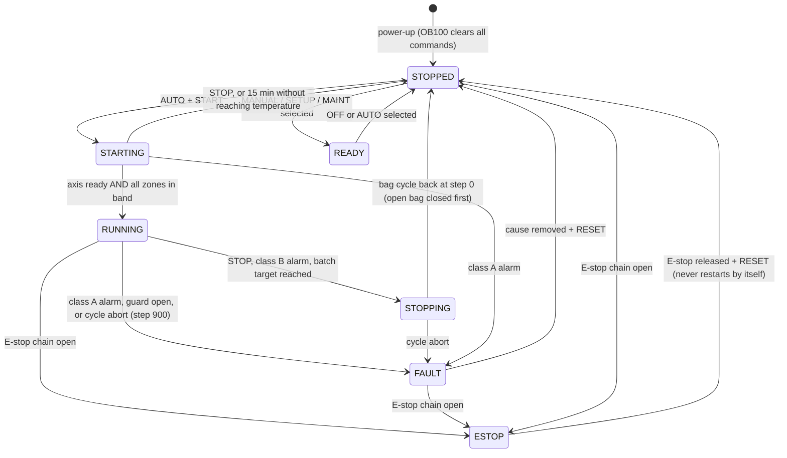
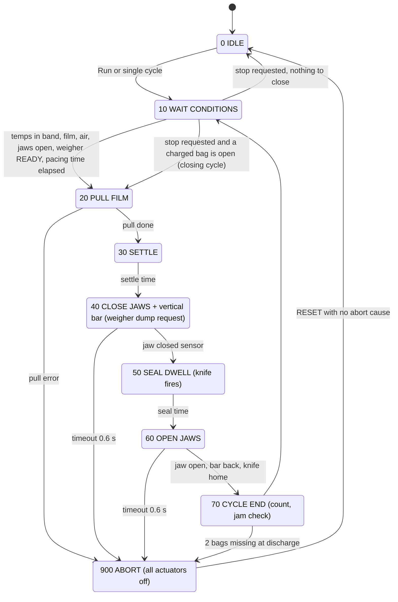
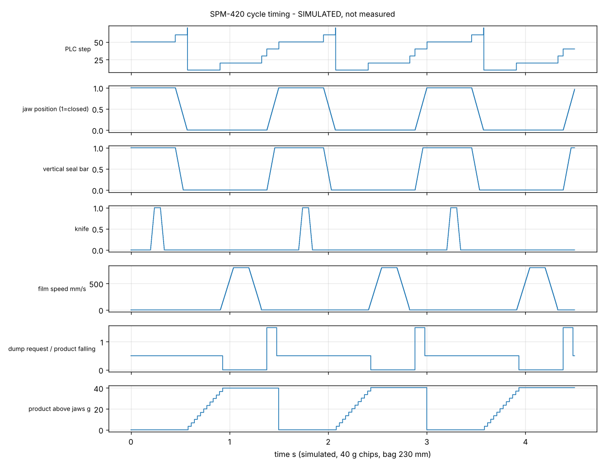

# Control sequences, state machines and timing

Implemented in `AUTOMATION/PLC/*.scl`; exercised by `SIMULATION/` (49 checks, all passing in the model).

## 1. Operating modes

| Mode | Who | What is possible | Conditions |
|---|---|---|---|
| 0 OFF | anyone | nothing moves, heaters off | default after power-up |
| 1 MANUAL | Maintenance user | single actuators by momentary button (jaw, vertical seal, knife with jaws closed, film jog, conveyors) | guards closed, safety OK, cycle idle |
| 2 SETUP | Setter | film jog forward, single cycle, empty bags (threading, length and seal trials) | guards closed, temperatures in band for sealing |
| 3 AUTO | Operator | continuous production | all start conditions |
| 4 MAINTENANCE | Maintenance user + key switch S4 | as MANUAL plus maintenance counters; weigher enable off | key removed -> back to OFF |

Mode changes are accepted only when the machine is STOPPED / READY / FAULT and the bag cycle is idle. No mode allows any hazardous movement with a guard open.

## 2. Machine state machine (`FB_ModeManager`)

## 3. Bag cycle (`FB_BagCycle`)

Product tracking: the charge requested in step 40 of cycle *n* lands in the bag whose bottom seal is being made in that step and leaves the machine in cycle *n+1*. Hence one empty leader bag after each start and one closing cycle at each stop (both verified in simulation S01/S03/S04).

## 4. Timing diagram

Simulated, reference recipe (230 mm bag, 40 bags/min): `timing_diagram_simulated.png`.

| Phase | Start s | Duration s | Actuator | Confirmed by |
|---|---|---|---|---|
| Film pull | 0.00 | 0.42 | servo, trapezoid 6 m/s², 0.8 m/s | axis done |
| Settle | 0.42 | 0.05 | - | timer |
| Jaws + vertical bar close | 0.47 | ~0.12-0.15 | Y1, Y2 | B5 |
| Weigher dump request | 0.47 + dump advance | 0.10 pulse | relay to weigher | dump-done pulse |
| Seal dwell | ~0.60 | 0.45 | heat + pressure | timer |
| Knife | dwell + 0.20 | 0.10 | Y3 | B8 on return |
| Jaws open | ~1.05 | ~0.12-0.15 | spring-return valves | B6, B7, B8 |
| Product falling (1.9 m) | from dump | lead ~0.70, tail ~1.05 after dump | gravity | must end before the next jaw close |
| Pacing wait | ~1.20 | to 1.50 | - | cycle timer |

Synchronisation rule: `dump advance + fall of the tail < cycle time - jaw close time`. At 40 bags/min: 0 + 1.05 < 1.50 - 0.15. The recipe value "dump advance" exists so that light, slow products can be given more of the cycle; the fall times must be measured per product (high-speed video) during commissioning.

## 5. Named sequences

**Startup (operator):** main switch on -> air on (pressure switch) -> log in -> select recipe -> heaters ON -> select AUTO -> START. PLC: STARTING (servo enabled, take-off conveyor on, weigher enabled, elevator on demand) -> RUNNING when all zones are within ± band -> first cycle makes an empty leader bag.

**Product feeding:** weigher "feed request" starts elevator + vibratory tray; they stop when the request drops or on a weigher fault; hopper-low gives a warning only.

**Weighing:** autonomous in the weigher. Bagger sees READY, issues DUMP REQUEST, receives DUMP DONE. No READY for 10 s -> warning 21, amber lamp, machine waits without pulling film.

**Packaging / sealing / cutting / discharge:** steps 20-70 above. Bag passing photo-eye B11 resets the jam counter.

**Shutdown (normal):** STOP -> STOPPING: current bag finished, charged bag closed, jaws open -> STOPPED; take-off runs 5 s longer; heaters stay on until switched off or mode OFF. End of shift: heaters off, weigher "empty out" at its own panel, mode OFF, main switch off after jaws < 60 °C if cleaning follows.

**Emergency stop:** hardware removes valve power, dumps air, STO, drops heater contactor - independent of the PLC. PLC: state ESTOP, alarm 1, all commands cleared, cycle to 900. Recovery: release button -> RESET (blue lamp) -> inspect jaws, remove partial bag -> START.

**Fault detection and recovery:** every alarm has class, reaction and recovery text (`AUTOMATION/PLC/alarms.csv`, shown on the HMI). Class A: immediate abort to a de-energised state. Class B: finish the bag, then stop. Class C: warning, no stop. First-out alarm is stored. One RESET clears alarms whose cause is gone; nothing restarts without START.

**Power interruption:** all outputs drop (jaws open by spring-return valves). After power returns the PLC starts in OFF/STOPPED with alarm 30 if it had been running; operator inspects, RESET, START.
