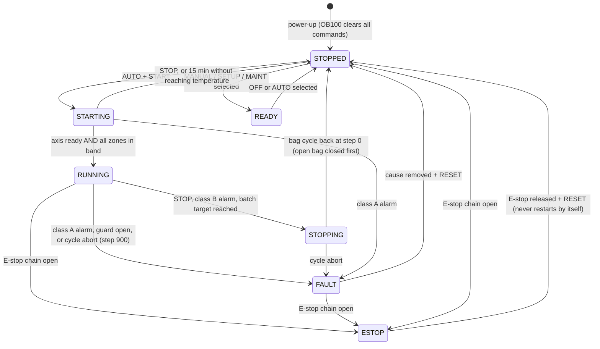
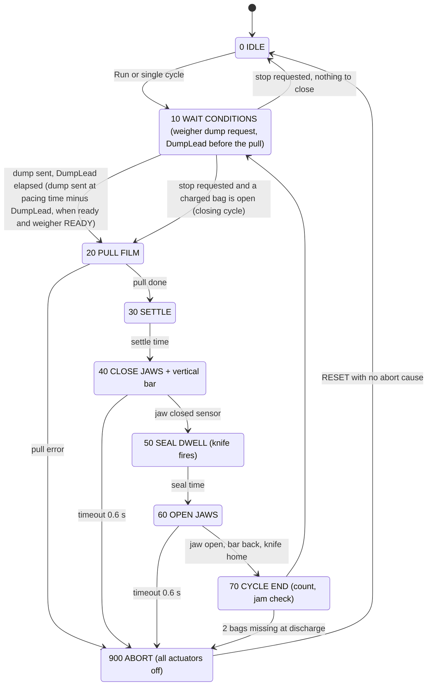

# Control sequences, state machines and timing

Implemented in `AUTOMATION/PLC/*.scl`; exercised by `SIMULATION/` (51 checks, all passing in the model).

## 1. Operating modes

| Mode | Who | What is possible | Conditions |
|---|---|---|---|
| 0 OFF | anyone | nothing moves, heaters off | default after power-up |
| 1 MANUAL | Maintenance user | single actuators by momentary button (jaw, vertical seal, knife with jaws closed, film jog, conveyors) | guards closed, safety OK, cycle idle |
| 2 SETUP | Setter | film jog forward, single cycle, empty bags (threading, length and seal trials) | guards closed, temperatures in band for sealing |
| 3 AUTO | Operator | continuous production | all start conditions |
| 4 MAINTENANCE | Maintenance user + key switch S4 | as MANUAL plus maintenance counters; weigher enable off | key removed -> back to OFF |

Mode changes are accepted only when the machine is STOPPED / READY / FAULT and the bag cycle is idle. No mode allows any hazardous movement with a guard open.

## 2. Machine state machine (`FB_ModeManager`)

## 3. Bag cycle (`FB_BagCycle`)

Product tracking: the charge requested in step 10 just before cycle *n* falls during the film pull, lands on the bottom seal made in steps 40-50 of cycle *n* while the jaws hold it, and leaves the machine in cycle *n+1*. Hence one empty leader bag after each start and one closing cycle at each stop (both verified in simulation S01/S03/S04).

## 4. Timing diagram

Simulated, reference recipe (230 mm bag, 40 bags/min): `timing_diagram_simulated.png`.

Times from the simulation trace, measured from the start of the film pull. The simulated cycle is 1.504 s against the 1.500 s recipe value (40 bags/min): the 2 ms scan of the model rounds the pacing and the 55 ms lead, at most one scan each.

| Phase | Start s | End s | Actuator | Confirmed by |
|---|---|---|---|---|
| Weigher dump request | -0.056 (DumpLead before the pull, in step 10) | +0.044 | 100 ms pulse, relay to weigher | dump-done pulse |
| Film pull | 0.000 | 0.422 | servo, trapezoid 6 m/s², 0.8 m/s | axis done |
| Settle | 0.422 | 0.474 | - | timer |
| Jaws + vertical bar close | 0.474 | 0.594 | Y1, Y2 | B5 |
| Seal dwell | 0.596 | 1.048 | heat + pressure | timer |
| Knife | 0.798 | 0.898 | Y3 | B8 on return |
| **Charge lands on the closed jaws** | **0.646** | **0.996** | gravity: 0.70 s fall + 0.35 s string | 52 ms after jaws closed, 52 ms before they start to open |
| Jaws open | 1.048 | 1.168 | spring-return valves | B6, B7, B8 |
| Pacing wait | 1.172 | 1.504 | - | cycle timer |

Synchronisation rule: the whole charge must land while the jaws are closed, so they carry it while the new bottom seal sets:

`t_closed  <  -DumpLead + t_fall          and          -DumpLead + t_fall + t_string  <  t_open`

with t_closed = 0.594 s and t_open = 1.048 s (both measured from the pull start, fixed by the recipe), t_fall ≈ 0.70 s and t_string ≈ 0.35 s (assumed, product-dependent). In the model this holds for DumpLead between about 10 and 100 ms; 55 ms centres the charge in the dwell. The window only exists while t_string is shorter than the dwell minus margins (0.45 s here): a product with a longer string needs a longer dwell or a lower speed. The pull starts at the pacing time, or DumpLead after the request if the weigher was late, so a late weigher shifts the whole cycle but not this relation. t_fall and t_string must be measured per product with high-speed video (calibration C10).

## 5. Named sequences

**Startup (operator):** main switch on -> air on (pressure switch) -> log in -> select recipe -> heaters ON -> select AUTO -> START. PLC: STARTING (servo enabled, take-off conveyor on, weigher enabled, elevator on demand) -> RUNNING when all zones are within ± band -> first cycle makes an empty leader bag.

**Product feeding:** weigher "feed request" starts elevator + vibratory tray; they stop when the request drops or on a weigher fault; hopper-low gives a warning only.

**Weighing:** autonomous in the weigher. Bagger sees READY, issues DUMP REQUEST in step 10 (DumpLead before the pull), receives DUMP DONE. Once the request is sent the film pull always follows, because the product is already falling. No READY for 10 s -> warning 21, amber lamp, machine waits without pulling film.

**Packaging / sealing / cutting / discharge:** steps 20-70 above. Bag passing photo-eye B11 resets the jam counter.

**Shutdown (normal):** STOP -> STOPPING: current bag finished, charged bag closed, jaws open -> STOPPED; take-off runs 5 s longer; heaters stay on until switched off or mode OFF. End of shift: heaters off, weigher "empty out" at its own panel, mode OFF, main switch off after jaws < 60 °C if cleaning follows.

**Emergency stop:** hardware removes valve power, dumps air, STO, drops heater contactor - independent of the PLC. PLC: state ESTOP, alarm 1, all commands cleared, cycle to 900. Recovery: release button -> RESET (blue lamp) -> inspect jaws, remove partial bag -> START.

**Fault detection and recovery:** every alarm has class, reaction and recovery text (`AUTOMATION/PLC/alarms.csv`, shown on the HMI). Class A: immediate abort to a de-energised state. Class B: finish the bag, then stop. Class C: warning, no stop. First-out alarm is stored. One RESET clears alarms whose cause is gone; nothing restarts without START.

**Power interruption:** all outputs drop (jaws open by spring-return valves). After power returns the PLC starts in OFF/STOPPED with alarm 30 if it had been running; operator inspects, RESET, START.
