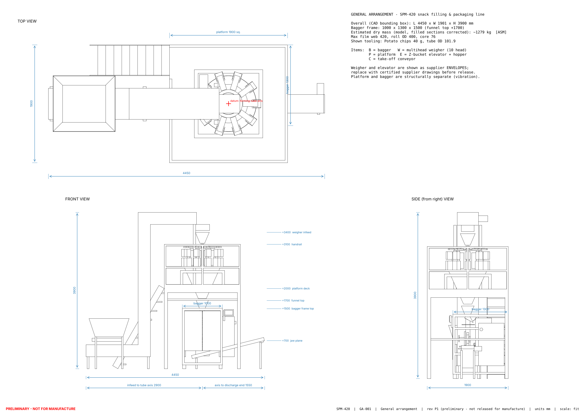
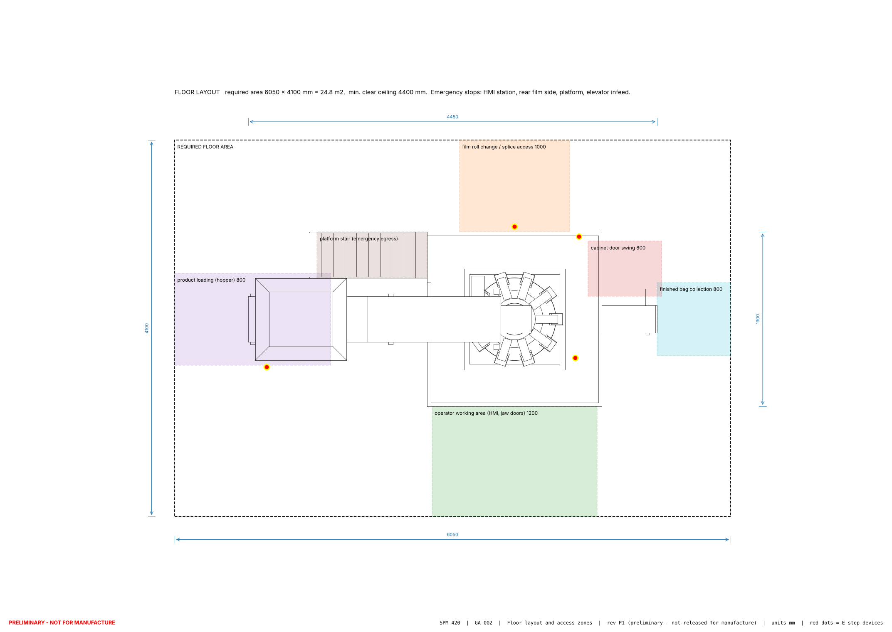

# 05 - Machine footprint and physical dimensions

Drawings: `CAD/DRAWINGS/GA-001_general_arrangement.(pdf|dxf|png)` (top, front, side, dimensioned) and `GA-002_floor_layout.(pdf|dxf|png)` (plan with access zones). 3D: `CAD/ASSEMBLY/SPM-420_assembly.step`.

## Overall dimensions (from the CAD bounding box, identical to the calculation sheet)

| | mm | Governed by |
|---|---|---|
| Total length (X) | **4450** | elevator infeed hopper (-2900) to end of take-off conveyor (+1550) |
| Total width (Y) | **1900** | weigher platform; bagger with film roll fits inside (rear face +950) |
| Total height (Z) | **3900** | elevator head above the weigher infeed (+3400) |
| Bagger alone | 1000 x 1300 x 1500 (funnel top +1700; with cabinet 1300 wide) | derivation below |
| Floor space incl. clearances | **6050 x 4100 = 24.8 m²** | zones below |
| Minimum clear ceiling | **4400** | 500 above the elevator head for hopper/bucket removal |

## How the bagger dimensions were derived

| Dimension | Build-up | Result |
|---|---|---|
| Width | roller face 450 (420 web + 30) + side plates and bearings 110 + two frame tubes 100 + servo/drive bay 140 + pneumatic and cable bay 200 | 1000 |
| Depth | front door to tube axis 350 (jaw opening + door + reach distance) + belt carriage and cross shaft 200 + dancer storage 250 + roll Ø400 + 100 clearance | 1300 |
| Jaw plane height | take-off belt 350 + longest bag 300 + 50 | +700 |
| Tube top / collar | jaw plane + 60 gap + 690 tube (250 belt contact + 320 vertical seal overlap zone + collar 130) | +1450 |
| Frame top / funnel top | top plate +1500, funnel 250 high | +1500 / +1700 |
| Platform deck | funnel top + chute engagement 300 | +2000 |
| Weigher base / top | deck + 150 legs; + 1250 weigher height [supplier-dependent] | +2150 / +3400 |

## Access and clearance zones (GA-002)

| Zone | Size | Location | Purpose |
|---|---|---|---|
| Operator working area | 1800 x 1200 | front (-Y) | HMI, start/stop, jaw doors, sample bags; E-stop at the HMI station |
| Film replacement | 1200 x 1000 | rear (+Y), roll axis at 520 mm height | roll trolley; splice table; E-stop on rear post |
| Product loading | 1700 x 1000 | left end at the infeed hopper (rim +1250: load from a 400 mm step or by bin tipper) | bulk bins/sacks; E-stop at hopper |
| Finished-bag collection | 800 x 800 | right end of take-off conveyor (discharge height ~+700) | packing table or next conveyor |
| Cabinet door | 800 deep in front of the door | right side, rear half | electrical access with door open >= 95° |
| Platform stair | 1200 x 500 run at 60° | left side, rear half (clear of the elevator) | weigher cleaning and adjustment, emergency egress; E-stop on the platform |
| Cleaning / maintenance | 800 all round | sides | removal of guards, conveyor, elevator covers |
| Emergency access | the 1200 front aisle and 1000 rear aisle are kept free of stored material | - | escape and first-aid access |

Electrical cabinet location: right side of the bagger, X +500...+800, Y +250...+850, Z +300...+1300; the take-off conveyor passes in front of it (Y ±150) without blocking the door.

## Status of these dimensions

| Preliminary (will change with supplier data) | Fixed by design input |
|---|---|
| weigher diameter/height/mass, elevator section and head height, platform deck height (follows the weigher chute), overall height | 420 mm web, bag ranges, tube diameters (pure geometry), roll size, bagger frame envelope, jaw plane height |

**No dimension in this project is a validated manufacturing dimension.** Validation happens when (1) supplier certified drawings are in hand and (2) the first assembly is measured against the GA.
