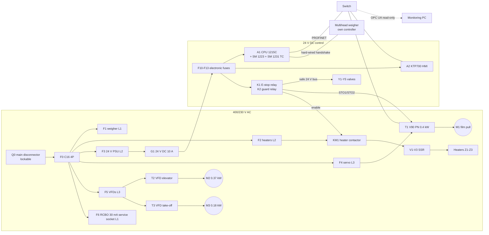

# 01 - Electrical and control architecture

Supply (assumed for Iraq / IEC markets): 3/N/PE AC 400/230 V 50 Hz, TN-S. Control voltage 24 V DC (PELV, 0 V bonded to PE at one point).

## Division of responsibility

| Layer | Device | Responsible for | Explicitly NOT responsible for |
|---|---|---|---|
| Safety | K1, K2, dump valve, STO, bimetal cut-outs | E-stop, guard interlock, removal of hazardous energy, over-temperature back-up | sequencing |
| Real-time control | S7-1200 CPU | bag cycle, temperature control, film index, alarms, modes | safety functions, per-bag weighing |
| Weighing | weigher controller | load cells, feeders, combination, weight statistics | bag cycle timing |
| Operation | KTP700 | parameters, recipes, alarms, manual functions | any safety function |
| Information | monitoring PC (FastAPI/PostgreSQL) | history, batches, reports | control: read-only OPC UA client, no write nodes exposed |

## Network (machine cell, isolated)

| Device | IP (proposal) | Protocol |
|---|---|---|
| A1 PLC X1 P1/P2 | 192.168.10.10 | PROFINET IO controller, S7, OPC UA server (port 4840) |
| A2 HMI | 192.168.10.11 | S7 HMI connection |
| T1 V90 PN | 192.168.10.12 | PROFINET IO device, PROFIdrive telegram 3 |
| Weigher (if Ethernet option) | 192.168.10.20 | Modbus TCP, information only |
| Monitoring PC | 192.168.10.50 (second NIC to plant LAN) | OPC UA client; HTTP(S) to users |

Security measures: machine subnet not routed to the office LAN; PLC access protection with password, PUT/GET off; OPC UA with user authentication, `Basic256Sha256` where the CPU firmware supports it, and only `DB_Machine`, `DB_Alarms`, `DB_Recipe` readable; monitoring PC is the only bridge and exposes its own API with token-protected write endpoints. Remote access, if ever needed, through a dedicated industrial VPN router, never by port forwarding.

## Controller evaluation

| Criterion | Siemens S7-1200 (1215C) | Comparable PLC (Mitsubishi FX5U, Omron CP2E/NX1P2, Delta DVP/AS, Schneider M241) | Low-cost prototype controller (Arduino Opta/Controllino, ESP32, Raspberry Pi) |
|---|---|---|---|
| Industrial approvals, EMC, 24 V I/O | yes (CE, UL) | yes | Opta/Controllino partly; bare boards no |
| Motion for one servo | PROFINET + technology object, or PTO | EtherCAT/pulse - equally capable | step/dir libraries; jitter under load |
| Temperature inputs | SM 1231 TC | equivalent modules | external MAX31855-type boards |
| HMI ecosystem | KTP Basic in the same tool | own panels / Weintek | web UI or serial panels |
| Local availability and technicians (Iraq / Middle East) | very good | Delta and Mitsubishi good, others variable | hobby channels only |
| Long-term spares (10+ years) | yes | yes | no guarantee |
| Cost of CPU + I/O + HMI + software [estimate] | ~2,300 USD | 1,200-2,500 USD | 150-400 USD |
| Suitable for | all three configurations | all three (re-write the SCL into the vendor dialect; logic is IEC 61131-3 ST) | educational prototype only, never with real safety relevance |

Selection: **S7-1200**. Reasons: the reference requirement names it, one tool for PLC + HMI + drive, integrated OPC UA server for monitoring, and service availability. FX5U or Delta AS are valid cost-down alternatives; the bag-cycle logic is plain Structured Text and ports directly, the motion and PID blocks do not.
