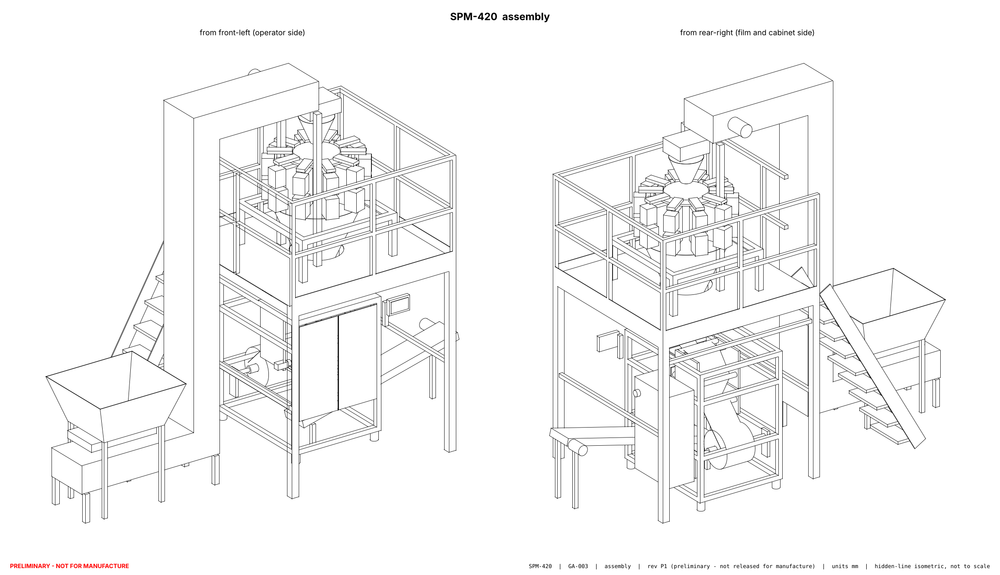
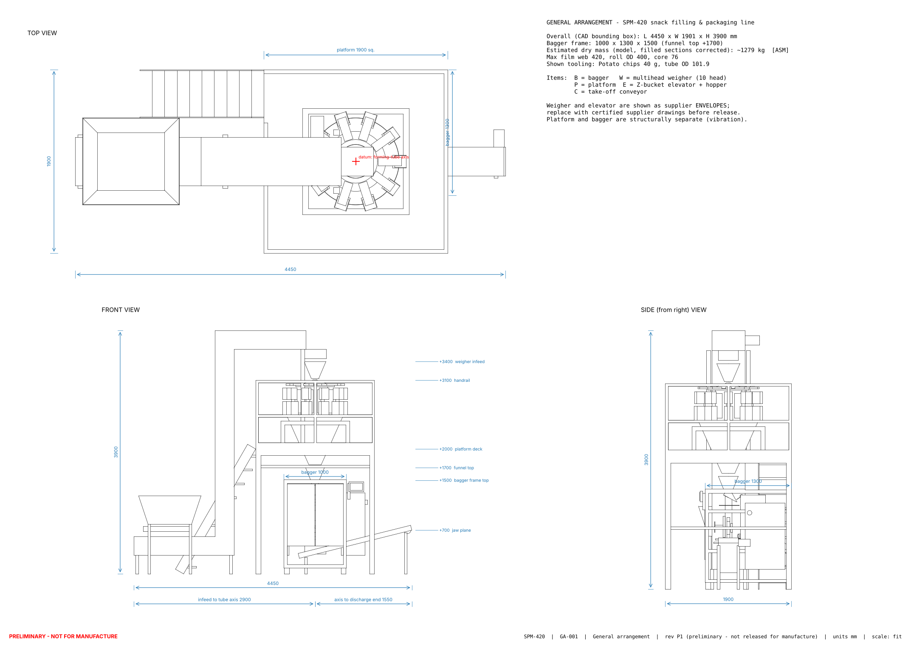

# SPM-420 - automatic snack filling and packaging machine

Engineering design package for a snack line (hopper -> Z-bucket elevator -> 10-head multihead weigher -> vertical form-fill-seal bagger -> take-off conveyor), inspired by the reference video <https://youtu.be/BCQ6pwSIyH4>.





## Read this first

* **Maturity:** preliminary design, checked by calculation and software simulation. Nothing has been built, compiled on a PLC or tested on hardware. Every performance figure is theoretical or simulated and labelled as such.
* **Reference video:** its frames could not be viewed from the build environment. The reference analysis is an inference from the title, the publisher's catalogue and published data for this machine class - see `DOCUMENTATION/01_REFERENCE_ANALYSIS.md` for the checklist to confirm it.
* **Not for manufacture as-is:** drawings are layout level, schematics are design level, prices are estimates. `DOCUMENTATION/REPORTS/final_engineering_report.md` lists every assumption and the steps to release.

## Key figures (theoretical)

| | |
|---|---|
| Line envelope | 4450 x 1900 x 3900 mm; floor with access 6050 x 4100 mm; ceiling 4400 mm |
| Bags | pillow, width 80-200 mm, length 80-300 mm, film web <= 420 mm |
| Rated speed | 40 bags/min (40 g chips, 160 x 230 mm bag); mechanical limit 49 |
| Utilities | 3/N/PE 400/230 V 50 Hz, 4.7 kW connected; air 0.19 m³/min at 0.6 MPa |
| Control | Siemens S7-1200 (CPU 1215C), KTP700 HMI, SINAMICS V90 PN servo, hard-wired safety |

## Project structure

| Folder | Content |
|---|---|
| `machine_params.py` | single source of truth for all parameters |
| `DOCUMENTATION/` | reference analysis, specification, calculations, mechanical design, footprint, product configuration, performance; `MANUFACTURING/`, `TESTING/`, `SAFETY/`, `REPORTS/` |
| `CAD/` | parametric model scripts, `ASSEMBLY/`, `COMPONENTS/`, `EXPLODED/`, `DRAWINGS/` (STEP, STL, DXF, PDF) |
| `ELECTRICAL/` | `SCHEMATICS/`, `WIRING/`, `PANEL/`, `BOM/` |
| `AUTOMATION/` | `PLC/` (Structured Text, I/O map, alarms), `HMI/` (specification, tags, prototype), `SEQUENCES/` (state machines, timing), `WEIGHER_CONTROLLER/` (C combination algorithm) |
| `SOFTWARE/` | `BACKEND/` (FastAPI), `FRONTEND/` (React), `DATABASE/` (PostgreSQL schema) |
| `SIMULATION/` | PLC-logic + plant model, fault scenarios, weigher Monte-Carlo, results |

## Regenerate and test

```
pip install cadquery ezdxf matplotlib pytest fastapi "uvicorn[standard]" sqlalchemy pydantic-settings httpx
make all
```

Open `AUTOMATION/HMI/hmi_prototype.html` in a browser for the HMI prototype.

## Safety

Emergency stop, guard interlocks, drive STO and heater over-temperature cut-out are hard-wired and independent of PLC and software. No bypass function exists or is described. The risk assessment is a design-stage draft that must be completed and validated on the real machine by a competent person before any use.
